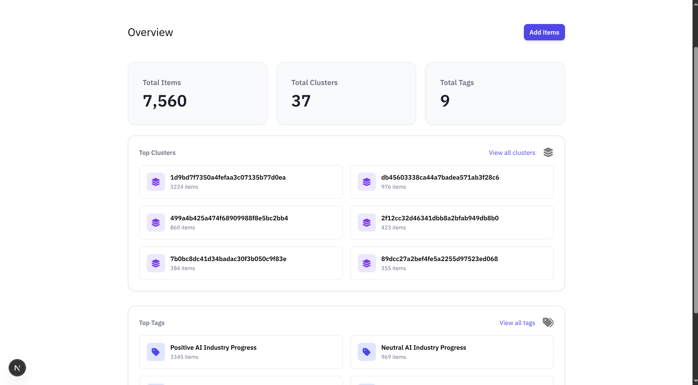
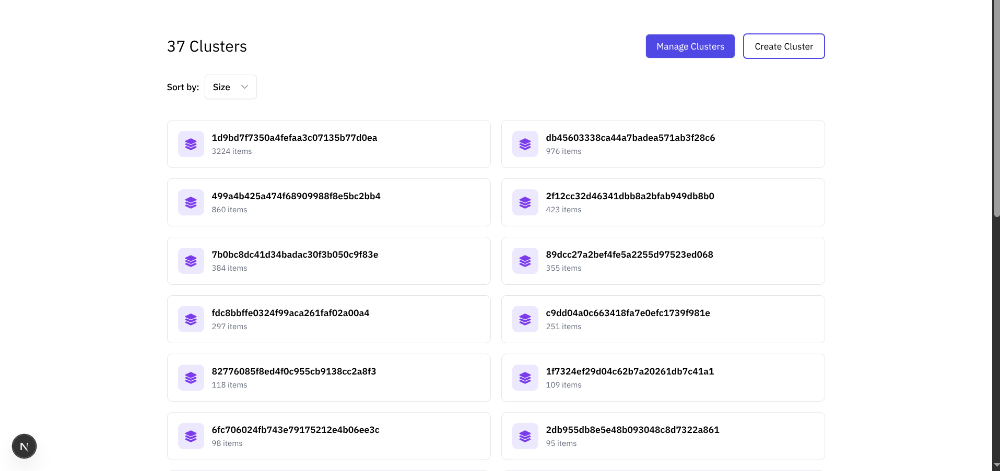
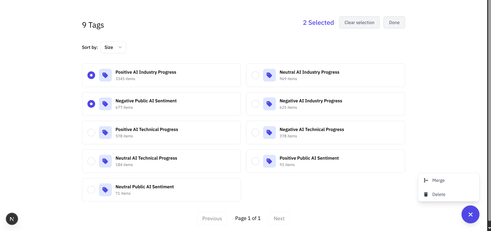
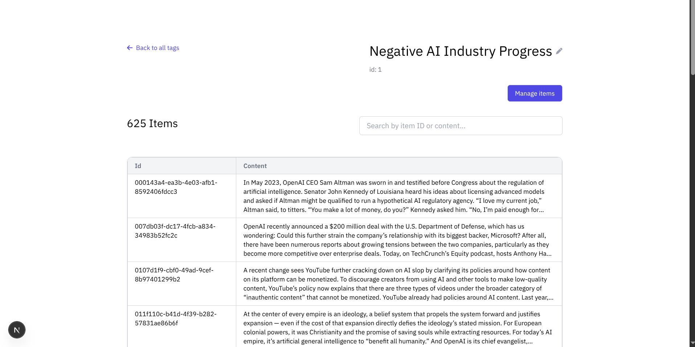
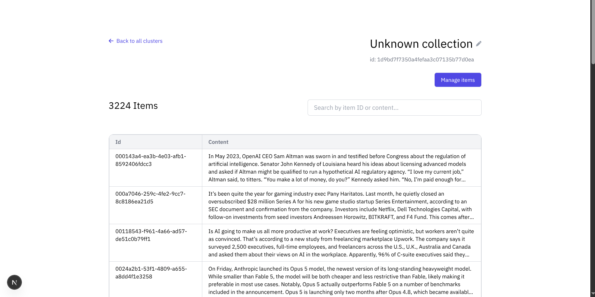

# Sereleum

  

|  |  |
|:---:|:---:|
|  |  |

Sereleum is a web client for document analysis and organisation, providing an interface for exploring documents and managing collections. It is built on top of [sereleum-core](https://github.com/dev-diaries41/sereleum-core), which provides the API and core functionality for document indexing, semantic clustering, automatic cluster labelling, and tagging.

## Core Features

Sereleum provides a unified interface for exploring and organising documents processed by sereleum-core.

### 1. Document Indexing

Index documents to make their content available for semantic analysis and organisation.

**What this enables:**

- Processing and indexing document content
- Semantic representation of documents
- Preparing documents for clustering and retrieval

### 2. Semantic Clustering

Automatically groups semantically similar documents into clusters, uncovering relationships and recurring themes across a document collection.

**What this enables:**

- Discovering groups of related documents
- Identifying recurring topics and themes
- Exploring relationships across documents

### 3. Automatic Cluster Labelling

Automatically generates descriptive labels for clusters, making groups of related documents easier to identify and navigate.

**What this enables:**

- Quickly understanding cluster contents
- Reducing manual organisation effort
- Providing meaningful descriptions for document groups

### 4. Tagging & Collections

Clusters and tags are abstracted into a unified concept: **Collections**.

Collections provide a consistent way to organise and manage documents, whether they are automatically grouped through clustering or manually organised through tagging.

**What this enables:**

- Organising documents into collections
- Managing and editing collections
- Grouping documents by semantic similarity or user-defined categories
- Combining automated organisation with manual curation

## Roadmap

- [ ] **Individual Item Labelling** – Use LLMs to automatically generate descriptive labels for individual documents, building on the existing tagging infrastructure.
- [ ] **Image Support** – Extend indexing and analysis capabilities beyond text documents to support images.

## Architecture

Sereleum consists of two components:

- **Sereleum** – Web client providing document exploration, collection management, and visualisation.
- **[Sereleum-Core](https://github.com/dev-diaries41/sereleum-core)** – Backend providing the API and core functionality for indexing, clustering, automatic cluster labelling, and tagging.