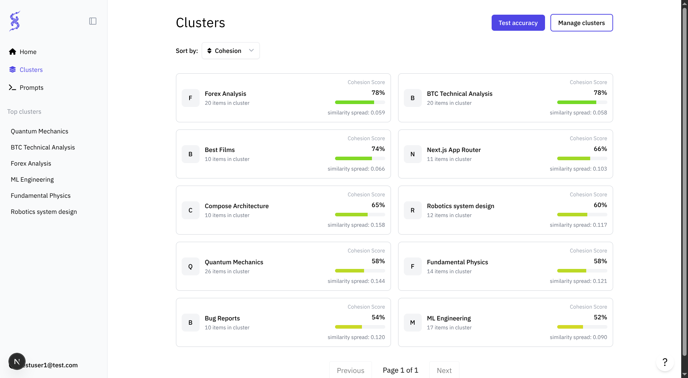
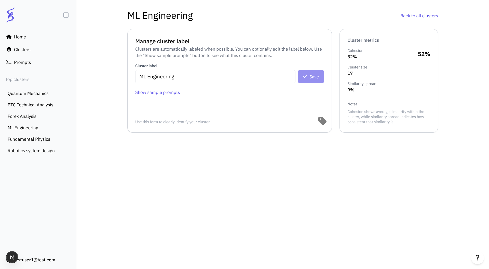
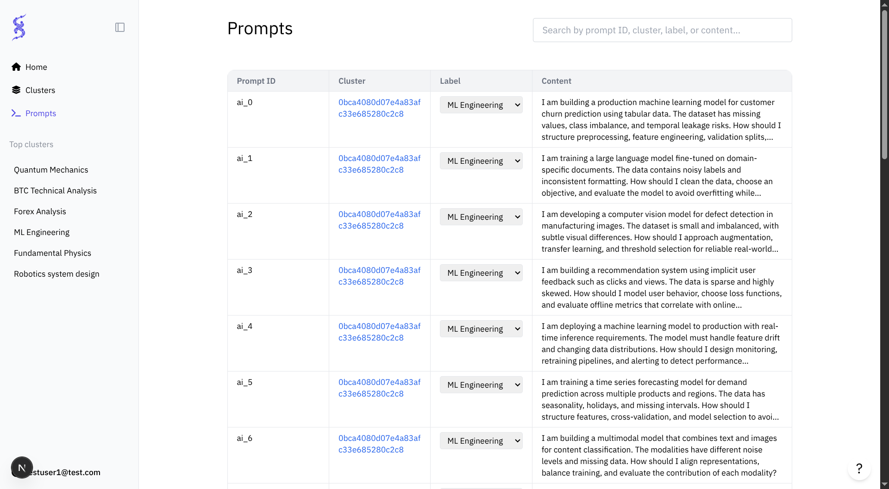
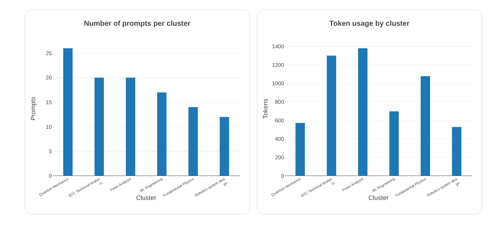

# Sereleum

  

|  |  |  |  |
|------------------------------------------------------------------------------------------------------------|------------------------------------------------------------------------------------------------------------|------------------------------------------------------------------------------------------------------------|------------------------------------------------------------------------------------------------------------|

Sereleum is a prompts analytics platform that allows businesses to turn user prompts into actionable insights. It enables uncovering semantic patterns, and optimising LLM-powered products. 

## Core Features

Sereleum focuses on analytics-driven controls that turn raw user prompts into standardized, high-quality, and cost-efficient interactions.

### 1. Prompt Clustering & Intent Discovery

Automatically groups semantically similar prompts and labels clusters to surface **dominant user intents and workflows**.

**What this enables:**

* Clear visibility into how users actually use your LLM-powered product
* Identification of repeatable, high-value use cases suitable for standardization
* Identify core product workflows

---

### 2. Token Usage & Cost by Cluster (Top 6)

Tracks token consumption and cost at the **use-case level**, focusing on the top 5 clusters that drive the majority of spend and traffic.

**Why top 6 only:**

* Captures the highest-impact intents
* Reduces noise and computational overhead
* Directs optimization efforts where ROI is highest

**What this enables:**

* Immediate visibility into which user intents are most expensive
* Prioritization of clusters for prompt optimization and templating

Both features can be used to guide decisions in product optimisations

---

